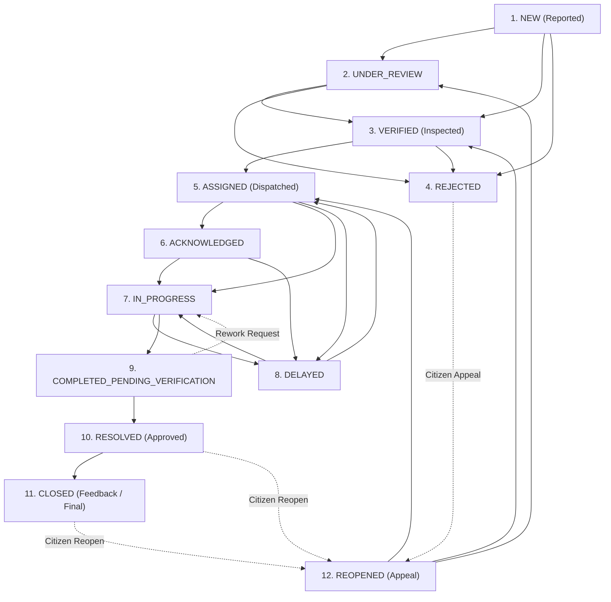

<<<<<<< HEAD
# CivicFix — Local Civic Issue Reporting & Resolution Tracking System

> **A professional, secure, and modern desktop application for municipal civic issue reporting, automated triage, field worker dispatch, progress tracking, and photographic resolution verification.**

---

## 📌 1. System Overview

**CivicFix** is a localized municipal management desktop application built with Python, Tkinter/ttk, and SQLite. It provides complete operational governance for three distinct municipal actors:

1. **Citizens**: Report neighborhood hazards with GPS/landmark locations, upload evidence photos, track real-time visual chronological progress, endorse community issues with "+1 Support", and submit 5-star resolution ratings.
2. **Field Technicians**: Inspect assigned municipal tasks, acknowledge receipt, update operational progress with notes, follow category-specific checklists, requisition repair materials, justify delays, and submit photographic proof of resolution.
3. **Municipal Administrators**: Oversee city-wide operations via an interactive command center, leverage rule-based priority recommendations, dispatch verified tasks to specialized departmental workers, detect and merge duplicate reports, audit worker completion proofs using a side-by-side Before/After widget, monitor embedded Matplotlib analytics, and export multi-table CSV spreadsheets.

---

## 🛠️ 2. Technology Stack

- **Platform**: Python 3.8+ Desktop Application (Windows 10/11)
- **GUI Framework**: Python Tkinter & ttk with custom clam styles
- **Relational Database**: SQLite 3 with Write-Ahead Logging (WAL) and enforced foreign key constraints
- **Data Visualization**: Matplotlib embedded in Tkinter (`FigureCanvasTkAgg`)
- **Image Processing**: Pillow (PIL) for aspect-ratio preserving thumbnails and high-resolution inspection
- **Security & Cryptography**: Salted PBKDF2-HMAC-SHA256 with 100,000 iterations, unique 256-bit salts, constant-time hash comparisons, and 100% parameterized queries
- **Data Export**: RFC 4180 compliant CSV exports with department and status filters

---

## 🎨 3. Design System — Modern Civic Palette 🌿

The application features a modern, clean, accessible, and professional civic theme designed for maximum clarity, readability, and visual hierarchy:

### Main Application Colors
| Color Token | Hex Code | Visual Swatch | Usage Role |
|---|---|---|---|
| `COLOR_PRIMARY` | `#789B83` | 🟩 Sage / Laurel Green | Primary action buttons, active navigation indicators, key accents |
| `COLOR_SECONDARY` | `#A3B18A` | 🫒 Soft Olive / Khaki Green | Secondary buttons, supporting badges, subtitle elements |
| `COLOR_BG` | `#F7F5EF` | ⬜ Warm Alabaster / Cream | Main application window background, outer containers |
| `COLOR_CARD` | `#FFFFFF` | ⬜ Pure White | Content cards, data tables, form fields, modal containers |
| `COLOR_ACCENT` | `#DDE8D5` | 🍃 Soft Celadon / Pistachio | Subtle pill badges, table headers, demo credential boxes |
| `COLOR_SIDEBAR` | `#405B4A` | 🌲 Deep Pine Forest Green | Left navigation sidebar background, hero container |
| `COLOR_HEADINGS` | `#263A32` | 🌲 Deep Cypress Green | Primary titles, modal headings, prominent metric labels |
| `COLOR_BODY` | `#4B5563` | 🔘 Slate Gray | Body copy, descriptions, helper text |
| `COLOR_BORDER` | `#E7E3D8` | 🌾 Warm Sand | Card boundaries, dividers, table borders, input outlines |

### Complaint Status Colors
| Status State | Hex Code | Visual Swatch | Usage Role |
|---|---|---|---|
| **Pending** (`NEW`, `UNDER_REVIEW`, `VERIFIED`, `ASSIGNED`, `REOPENED`) | `#E9A23B` | 🟧 Warm Amber | Pending verification, awaiting worker dispatch |
| **In Progress** (`ACKNOWLEDGED`, `IN_PROGRESS`, `DELAYED`, `COMPLETED_PENDING_VERIFICATION`) | `#6B9A91` | 🟦 Teal Slate | Field work active, repair ongoing, pending review |
| **Resolved** (`RESOLVED`, `CLOSED`) | `#4F9565` | 🟩 Forest Green | Physical repair verified, approved, and closed |
| **Rejected** (`REJECTED`) | `#D66B6B` | 🟥 Soft Coral Red | Invalid reports, duplicates, or out-of-scope issues |

---

## 🔄 4. State Machine & 12-State Lifecycle

CivicFix enforces a strict, centralized finite state machine (`services/state_machine.py`) governing all complaint transitions with role-based permission guards and multi-party notification triggers:



### Role Transition Permissions:
- **Citizen**: Can close resolved complaints via feedback (`RESOLVED` $\rightarrow$ `CLOSED`) or submit reopening appeals (`RESOLVED`, `CLOSED`, `REJECTED` $\rightarrow$ `REOPENED`).
- **Field Worker**: Can transition assigned tasks (`ASSIGNED` $\rightarrow$ `ACKNOWLEDGED` $\rightarrow$ `IN_PROGRESS` $\rightarrow$ `DELAYED` $\rightarrow$ `COMPLETED_PENDING_VERIFICATION`). Cannot mark complaints resolved.
- **Administrator**: Comprehensive governance authority over verification, rejection, dispatch, audit sign-off, rework requests, and ticket closure.

---

## 🗄️ 5. Relational Database Schema (14 Normalized Tables)

The database schema (`database/schema.py`) is structured across 14 normalized tables and 17 query performance indexes:

```
                      +-------------------+
                      |       Users       |
                      +-------------------+
                                |
        +-----------------------+-----------------------+
        | 1:1                   | 1:1                   | 1:N
+-----------------+     +-----------------+     +-------------------+
| CitizenProfiles |     | WorkerProfiles  |     | AdminActionHistory|
+-----------------+     +-----------------+     +-------------------+
        |
        | 1:N
        v
+-----------------+ 1:N +--------------------+ 1:N +---------------------+
|   Complaints    |----->| WorkerAssignments  |----->| WorkerProgressUpdates |
+-----------------+      +--------------------+      +---------------------+
  |   |   |   |                   |
  |   |   |   |                   | 1:N
  |   |   |   |                   +----------------->+--------------------+
  |   |   |   |                   |                  | WorkChecklistItems |
  |   |   |   |                   | 1:N              +--------------------+
  |   |   |   |                   +----------------->+--------------------+
  |   |   |   |                                      |MaterialRequirements|
  |   |   |   |                                      +--------------------+
  |   |   |   +------------------------------------->+--------------------+
  |   |   | 1:N                                      |  ComplaintImages   |
  |   |   |                                          +--------------------+
  |   |   +----------------------------------------->+--------------------+
  |   | 1:N                                          |ComplaintStatusHist |
  |   |                                              +--------------------+
  |   +--------------------------------------------->+--------------------+
  | 1:N                                              | ComplaintSupports  |
  |                                                  +--------------------+
  | 1:1                                              +--------------------+
  +------------------------------------------------->|      Feedback      |
  |                                                  +--------------------+
  | 1:N                                              +--------------------+
  +------------------------------------------------->|   Notifications    |
                                                     +--------------------+
```

---

## 📸 6. Side-by-Side Before/After Photo Verification Widget

Located in `gui/comparison_widget.py`, this reusable component connects citizen evidence with field worker repair proofs across all three user dashboards:

- **Dual Cards**:
  - **🔴 BEFORE Card**: Displays citizen initial evidence photo with submission timestamp, reporter name, and street context.
  - **🟢 AFTER Card**: Displays field worker resolution proof photo with completion timestamp, technician name, department, and completion notes.
- **Turnaround Analytics Badge**: Computes and displays the exact elapsed resolution turnaround (e.g. `⏱ Resolution Turnaround: 28.5 hours`).
- **Interactive Enlarge Modal**: High-resolution zoom dialog displaying full photographic detail.
- **Graceful Fallbacks**: Informative placeholder states for text-only complaints or pending repairs.

---

## 📁 7. Project Directory Structure

```
c:\civicfix new/
│
├── main.py                          # Application entry point & session router
├── requirements.txt                 # Dependencies (Pillow, matplotlib)
├── README.md                        # Project manual & system documentation
├── DEMO_GUIDE.md                    # Step-by-step interactive demonstration guide
│
├── authentication/                  # Security & authentication layer
│   ├── auth.py                      # Session manager & account provisioning
│   └── password_manager.py          # Salted PBKDF2-HMAC-SHA256 (100k rounds)
│
├── database/                        # Data layer & SQLite engine
│   ├── db_connection.py             # WAL mode connection & foreign key enforcement
│   ├── schema.py                    # 14 normalized tables & 17 performance indexes
│   ├── database_operations.py       # Parameterized queries & atomic transactions
│   └── demo_data.py                 # Idempotent demo data seeder & sample images
│
├── gui/                             # User interface presentation layer
│   ├── app.py                       # Root application shell & router
│   ├── login.py                     # Two-section modern blue-and-white login window
│   ├── register.py                  # Citizen self-registration interface
│   ├── components.py                # StatCard, DataTable, SearchBar, StatusBadge
│   ├── comparison_widget.py         # Side-by-Side Before/After photo comparison
│   ├── styles.py                    # Blue Theme 💙 styling constants & ttk styles
│   ├── citizen_dashboard.py         # 7-tab Citizen Operations Portal
│   ├── admin_dashboard.py           # 12-tab Municipal Administrator Command Center
│   └── worker_dashboard.py          # 8-tab Field Worker Operations Portal
│
├── modules/                         # Role-specific business controllers
│   ├── citizen.py                   # CitizenController
│   ├── administrator.py             # AdministratorController
│   └── field_worker.py              # WorkerController
│
├── services/                        # Business logic & operational services
│   ├── complaint_service.py         # Complaint lifecycle, timeline & feedback
│   ├── assignment_service.py        # Worker dispatch, departments & workloads
│   ├── priority_service.py          # Rule-based priority recommendation engine
│   ├── report_service.py            # Analytics, Before/After pairing & CSV exports
│   └── state_machine.py             # 12-state finite transition machine & guards
│
├── utils/                           # Helper utilities & validators
│   ├── complaint_id.py              # CFX-2026-XXXXXX unique code generator
│   ├── image_handler.py             # Image validation, storage & thumbnailing
│   └── validators.py                # Regex validators (phone, email, username)
│
├── scripts/                         # Command-line diagnostics & runners
│   ├── run_all_tests.py             # Comprehensive test discovery runner
│   ├── verify_database.py           # SQLite PRAGMA health & integrity inspector
│   └── generate_system_audit.py     # System audit markdown report generator
│
├── reports/                         # Audit reports & evaluation artifacts
│   └── SYSTEM_AUDIT_REPORT.md       # Comprehensive 44-test invariant audit report
│
├── uploads/                         # Image asset storage
│   ├── complaint_images/            # Citizen submission photos
│   └── completion_images/           # Worker completion proof photos
│
└── tests/                           # Unit & integration test suites (44 Tests)
    ├── test_workflow.py             # Field worker operations & workflow (8 tests)
    ├── test_database_integrity.py   # PRAGMA checks, cascades & indexes (7 tests)
    ├── test_state_machine.py        # 12-state transitions & notifications (12 tests)
    ├── test_analytics_and_reporting.py # Analytics, Before/After & CSV (10 tests)
    └── test_system_integration.py   # Multi-role concurrency & invariants (7 tests)
```

---

## 🔑 8. Default Pre-Seeded Demo Accounts

The application includes pre-configured municipal demonstration accounts:

| Role | Username | Password | Department / Locality | Default Capabilities |
|---|---|---|---|---|
| **Administrator** | `admin` | `Admin@123` | Municipal Governance | Full command oversight, verification queue, worker dispatch, duplicate detection, CSV exports, audit log |
| **Field Worker** | `worker_raj` | `Worker@123` | Roads | Assigned tasks, acknowledgment, checklists, progress notes, material requisitions, proof uploads |
| **Field Worker** | `worker_anita` | `Worker@123` | Electrical Maintenance | Streetlights, electrical maintenance, completion proof photos |
| **Citizen 1** | `citizen_rahul` | `Citizen@123` | Indiranagar | File complaints, upload photos, track timelines, community upvote, rate resolved issues |
| **Citizen 2** | `citizen_priya` | `Citizen@123` | Koramangala | Neighborhood reports, timeline tracking, reopening appeals |
| **Citizen 3** | `citizen_arun` | `Citizen@123` | Whitefield | Community issue browsing, civic endorsements |

---

## 🚀 9. Installation & Running Instructions

### Prerequisites
- Python 3.8 or higher installed on Windows.
- Standard libraries (`sqlite3`, `tkinter`) are included with standard Python installations.

### Step 1: Clone or Navigate to the Project Directory
```powershell
cd "c:\civicfix new"
```

### Step 2: (Optional) Create & Activate a Virtual Environment
```powershell
python -m venv venv
.\venv\Scripts\activate
```

### Step 3: Install Required Dependencies
```powershell
pip install -r requirements.txt
```
*(Dependencies: `Pillow>=9.0.0` for image handling, `matplotlib>=3.5.0` for embedded charts)*

### Step 4: Run the Application
```powershell
python main.py
```

---

## 🧪 10. Automated Test Suite Execution (44 Tests)

Run all 44 automated unit and integration tests across the entire application in one command:

```powershell
python scripts/run_all_tests.py
```

### Individual Test Suites:
```powershell
# 1. Field Worker Operations & End-to-End Workflow (8 Tests)
python -m unittest tests/test_workflow.py -v

# 2. Database PRAGMAs, Cascades & Optimization (7 Tests)
python -m unittest tests/test_database_integrity.py -v

# 3. State Machine 12-State Transitions & Triggers (12 Tests)
python -m unittest tests/test_state_machine.py -v

# 4. Advanced Analytics, Before/After & CSV Exports (10 Tests)
python -m unittest tests/test_analytics_and_reporting.py -v

# 5. Multi-Role Concurrency, Security & Invariants (7 Tests)
python -m unittest tests/test_system_integration.py -v
```

### Database Health Check:
```powershell
python scripts/verify_database.py
```

---

## 📈 11. Development Phases Summary (All 12 Phases Completed)

- [x] **Phase 1: Environment & Workspace Setup** — Directory structure, dependency configuration, error boundary diagnostics.
- [x] **Phase 2: Database Schema & Connection** — 14 normalized tables, 17 indexes, foreign key enforcement, WAL mode.
- [x] **Phase 3: Security & Auth Module** — Salted PBKDF2-HMAC-SHA256 (100k rounds), session manager, input validation, demo seeder.
- [x] **Phase 4: GUI Shell & Components** — Blue Theme 💙 styling constants, StatCard, DataTable, SearchBar, StatusBadge.
- [x] **Phase 5: Citizen Module** — Issue reporting, unique CFX IDs, photo upload, visual timeline tracking, feedback.
- [x] **Phase 6: Admin Module** — Priority recommendation engine, verification queue, worker dispatch, duplicate detection, embedded Matplotlib analytics.
- [x] **Phase 7: Field Worker Module** — Task scoping, acknowledgment, category checklists, material requisitions, delay reporting, completion proof upload.
- [x] **Phase 8: Database Integrity & Optimizations** — PRAGMA verifier, cascade deletes, `EXPLAIN QUERY PLAN` index benchmarks.
- [x] **Phase 9: State Machine & Audit Engine** — 12 discrete states, role transition guards, automated multi-party notifications, double-entry audit logging.
- [x] **Phase 10: Advanced Analytics & Before/After Comparison** — Reusable `BeforeAfterComparisonWidget`, department efficiency metrics, 24-column CSV exports.
- [x] **Phase 11: End-to-End System Testing & Invariants** — 44 automated tests across 5 test suites, SQL injection resilience, concurrency validation.
- [x] **Phase 12: Documentation, Demo Script & Final Polish** — Comprehensive `README.md`, `DEMO_GUIDE.md`, sample image generation, production readiness.
=======
# CivicFix
local issue reporting and resolution tracking system
>>>>>>> 8d4dcbbd99ab7c7297bfbb7b686d6584e89e4570
